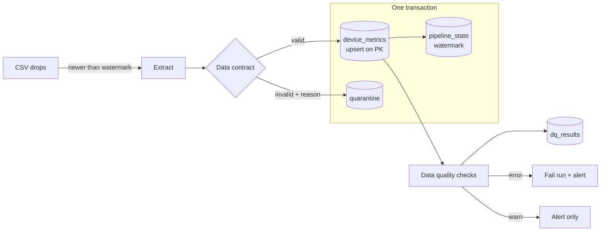

# DataOps Reliable Pipeline

[](https://github.com/maxifalco18/dataops-reliable-pipeline/actions/workflows/ci.yml)


A small, runnable reference for the practices that keep a data pipeline trustworthy in production: **data contracts, idempotent incremental loads, data quality gates, alerting, structured logs, tests and CI**.

The domain is synthetic network telemetry (devices × metrics × time). The core runs on the Python standard library and SQLite, so it can be cloned and run in a minute; the same patterns carry over to Postgres, Spark or a cloud warehouse.

## Architecture



## What it demonstrates

| Practice | How |
|---|---|
| **Data contract** | [`contracts/device_metrics.json`](contracts/device_metrics.json) defines schema, types, allowed values, ranges and primary key. Versioned with the code. |
| **Quarantine, not silent drops** | Records that break the contract go to a `quarantine` table with the exact reason, ready to review and replay. |
| **Idempotency** | Upserts on the contract's primary key: re-running or backfilling never creates duplicates. |
| **Atomic state** | Data, quarantine and watermark are committed in one transaction, so a failed run leaves no partial state and can simply be retried. |
| **Incremental loads** | A per-pipeline watermark skips rows that were already processed. |
| **Data quality gates** | Post-load checks (not empty, no nulls, unique keys, freshness, quarantine ratio). `error` checks fail the run; `warn` checks only alert. Results are stored in `dq_results` for trend dashboards. |
| **Alerting** | Console by default; set `ALERT_WEBHOOK_URL` to post to a Slack / Teams-compatible webhook. |
| **Observability** | JSON logs with `run_id` and row counts (ready for ELK / OpenSearch), plus a `pipeline_runs` audit table. |
| **Resilience** | Exponential-backoff retries for transient I/O errors only; real bugs fail fast. |
| **Orchestration** | [`dags/dataops_pipeline_dag.py`](dags/dataops_pipeline_dag.py): hourly Airflow DAG with retries and `max_active_runs=1`. The pipeline has no Airflow dependency, so it stays testable. |
| **CI** | Lint, unit tests on Python 3.10 and 3.12, and an end-to-end smoke run that checks the second run is a no-op. |

## Quickstart

```bash
git clone https://github.com/maxifalco18/dataops-reliable-pipeline.git
cd dataops-reliable-pipeline
python -m venv .venv && source .venv/bin/activate
make install
make demo
```

`make demo` generates fresh telemetry (with four deliberately broken rows), runs the pipeline, then runs it again. Expected output (JSON logs):

```json
{"msg": "run finished", "read": 124, "loaded": 120, "quarantined": 4, "status": "success"}
{"msg": "run finished", "read": 0, "loaded": 0, "quarantined": 0, "status": "success"}
```

Inspect the results:

```bash
sqlite3 data/warehouse.db "SELECT reason FROM quarantine;"
sqlite3 data/warehouse.db "SELECT check_name, severity, passed, detail FROM dq_results;"
sqlite3 data/warehouse.db "SELECT run_id, status, rows_read, rows_loaded, rows_quarantined FROM pipeline_runs;"
```

## Configuration

| Variable | Default | Purpose |
|---|---|---|
| `PIPELINE_INPUT_DIR` | `data/input` | Folder with CSV drops |
| `PIPELINE_DB_PATH` | `data/warehouse.db` | SQLite warehouse |
| `PIPELINE_CONTRACT` | `contracts/device_metrics.json` | Data contract |
| `PIPELINE_FRESHNESS_HOURS` | `24` | Max age of the newest record |
| `ALERT_WEBHOOK_URL` | *(empty)* | Slack / Teams-compatible webhook |

## Project structure

```
├── contracts/            # Data contracts (schema + rules), versioned with the code
├── src/dataops_pipeline/
│   ├── contract.py       # Contract loading and record validation
│   ├── extract.py        # Incremental CSV extraction by watermark
│   ├── store.py          # Warehouse access: upserts, quarantine, state, run log
│   ├── quality.py        # Post-load data quality checks
│   ├── alerting.py       # Console / webhook notifiers
│   ├── retry.py          # Exponential backoff for transient errors
│   ├── logging_utils.py  # JSON structured logging
│   └── pipeline.py       # Orchestration + CLI
├── dags/                 # Airflow DAG
├── scripts/              # Synthetic data generator
└── tests/                # Contract, pipeline (idempotency, watermark, DQ, alerts) and retry tests
```

## Running the tests

```bash
make test   # 15 tests, under a second
make lint
```

## Author

**Maximiliano Falco** · Data Engineer | DataOps · [LinkedIn](https://www.linkedin.com/in/maximilianofalco/)
